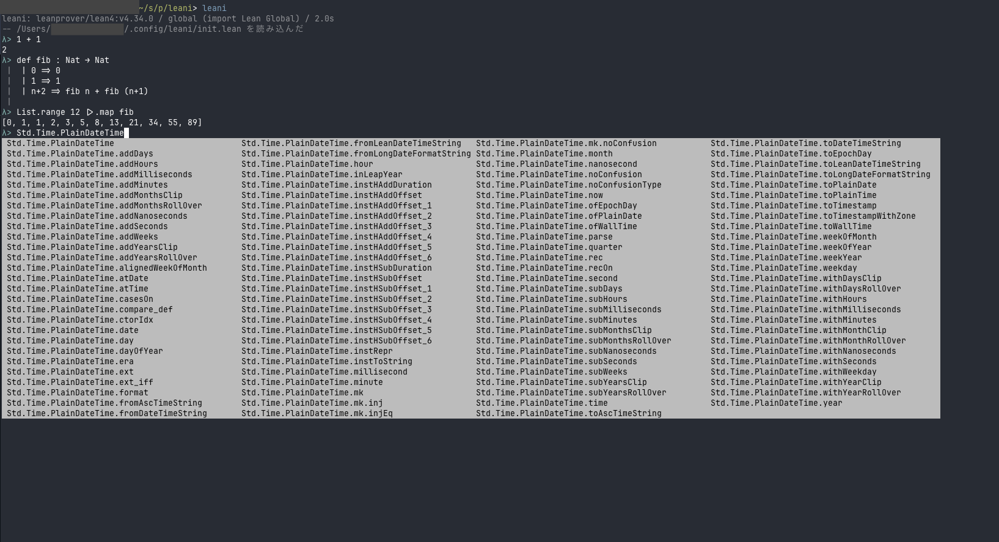

<div align="center">

# leani

**Lean 4 を、その場で試す REPL**



[証明モード](guide/proof.ja.md) · [設定](guide/config.ja.md) · [Jupyter](guide/jupyter.ja.md) · [できること](SPEC.ja.md) · [開発メモ](DEVELOPMENT.ja.md)

[English](README.md)

</div>

## インストール

[elan](https://lean-lang.org/install)、git、[Rust の toolchain](https://rustup.rs/) が必要。

```sh
cargo install --git https://github.com/watanany/leani leani
```

## 使い方

```sh
leani              # 起動する
leani -i Mathlib   # Mathlib を import して起動する
leani file.lean    # file.lean を読み込んで起動する
```

REPL の中では `:help` でコマンドの一覧を表示する。
`:l file.lean` でファイルを読み込む。
`module` で始まるファイルも読み込めるが、その中の宣言は private が既定なので、`public` を付けていない名前は Tab の候補に出ない。評価はできる。

> [!NOTE]
> 初回は leanprover-community/repl をビルドするので、時間がかかる。
> Lake プロジェクトの中では、先に `lake build` (Mathlib なら `lake exe cache get`) を実行しておく。
> Lake プロジェクトの中で初めて起動したときは、`lake env` が依存パッケージを取得することがある。
