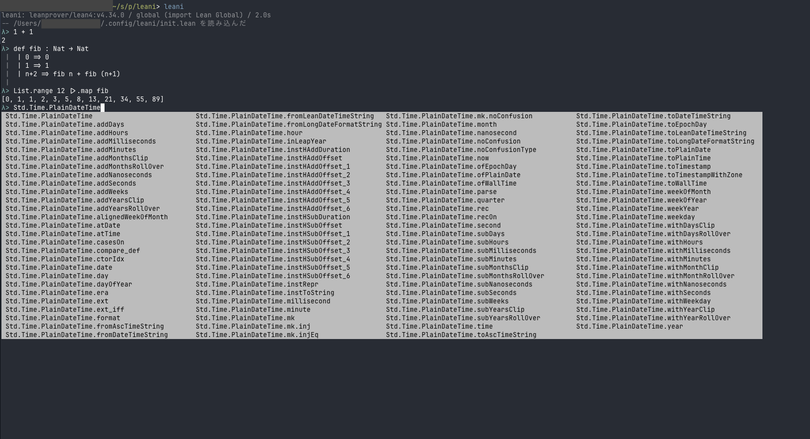

<div align="center">

# leani

**A REPL for trying Lean 4 on the spot**



[Proof mode](guide/proof.md) · [Configuration](guide/config.md) · [Jupyter](guide/jupyter.md) · [What leani can do](SPEC.en.md) · [Development notes](DEVELOPMENT.md)

[日本語](README.ja.md)

</div>

## Installation

[elan](https://lean-lang.org/install), git, and the [Rust toolchain](https://rustup.rs/) are required.

```sh
cargo install --git https://github.com/watanany/leani leani
```

## Usage

```sh
leani              # start
leani -i Mathlib   # start with Mathlib imported
leani file.lean    # start with file.lean loaded
```

In the REPL, `:help` shows the list of commands.
`:l file.lean` loads a file.
Files that start with `module` can also be loaded, but declarations in them are private by default, so names without `public` do not appear in the Tab candidates. They can still be evaluated.

> [!NOTE]
> The first start takes time because leani builds leanprover-community/repl.
> In a Lake project, run `lake build` first (for Mathlib, `lake exe cache get`).
> The first time leani starts in a Lake project, `lake env` may fetch dependency packages.
